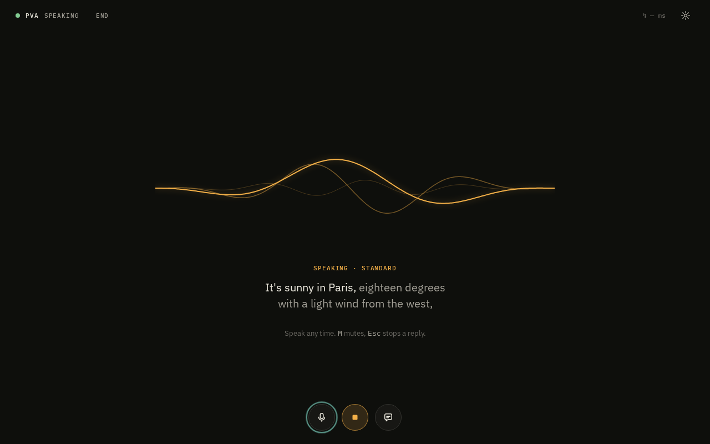

# @pva/web: the assistant's browser UI

The page is the owner's microphone, speaker and control surface. Open it, press **Start talking**, and talk. Design: [docs/UI-AND-MODULES.md](../../docs/UI-AND-MODULES.md) §3 (UI), §2 (protocol), §5 (echo). Stack: Next.js 16 (App Router, static export), React 19, Tailwind 4, Effect 4.



All screenshots are in [`screenshots/`](screenshots/): every visual state, the chat, the options, phone sizes and the light theme (from the mock), and `real-*.png` taken from the real assistant.

## Running it

| What | Command |
|---|---|
| UI + mock assistant (no real server needed) | `pnpm --filter @pva/web dev:mock`, then open http://localhost:3000 |
| UI against the real assistant, production | `pnpm serve` from the repository root (builds `out/`, then `pnpm start serve` serves it and the socket on http://127.0.0.1:8787) |
| UI against the real assistant, with hot reload | `pnpm dev` from the repository root (the assistant on :8787 and `next dev` on :3000; the dev page connects to `ws://<host>:8787/ws`) |
| Production build | `pnpm --filter @pva/web build` → `apps/web/out/` (static files; the assistant's server serves them and the WebSocket on one origin) |
| Mock only | `pnpm --filter @pva/web mock` (`MOCK_SCENARIO=voice` etc., see below) |

Socket address: `?ws=ws://host:port/ws` in the page URL overrides everything; then `NEXT_PUBLIC_PVA_WS_URL` at build time; in `next dev`, `ws://<page host>:8787/ws`; otherwise the page's own origin + `/ws`. The microphone only works on `https://` or `http://localhost` (use an SSH tunnel from another machine: `ssh -L 8787:localhost:8787 <host>`).

## Tests

| What | Command | Notes |
|---|---|---|
| Type check | `pnpm --filter @pva/web check` | App, worklets (`// @ts-check` JS), mock |
| Unit tests (vitest) | `pnpm --filter @pva/web test` | Reducer and store (driven by `@pva/protocol/examples`), forms, the connection layer against a real `ws` server, and the worklets in Node with a minimal `AudioWorkletProcessor` shim |
| End-to-end (Playwright) | `pnpm --filter @pva/web e2e:install` once (Chrome Headless Shell, ~280 MB in `~/.cache/ms-playwright`), then `pnpm --filter @pva/web e2e` | Headless Chromium with a fake microphone, against the mock. Builds the export first; the full suite runs on `out/` served by a plain static file server (`scripts/serve-static.mjs`), a smoke test on `next dev` |
| Screenshots | `pnpm --filter @pva/web screenshots` | Rewrites the mock screenshots in `screenshots/` |
| End-to-end against the **real** assistant | `pnpm e2e:real` from the repository root (= `pnpm --filter @pva/web e2e:real`) | `e2e-real/`, config `playwright.real.config.ts`: the built page in headless Chromium, fake microphone fed from 48 kHz WAVs built from `bench-audio/`, each file starting its own `serve` (local speech models, `LLM_PROVIDER=fake`). 10 tests, ~1.5 min. Skips when the models, `bench-audio/` or Chromium are missing. Logs in `test-results/real/` |
| Latency through the browser | `pnpm bench:browser` from the repository root | 10 spoken turns with the fake model at 300 ms to first token; prints a table and writes `test-results/real/latency.json` |
| Screenshots of the real system | `pnpm --filter @pva/web screenshots:real` | Rewrites `screenshots/real-*.png` (desktop and phone: a reply playing, the chat, the options) |

The root `pnpm check` and `pnpm test` include the web app.

## The mock assistant (`mock/server.ts`)

Speaks the real protocol (`@pva/protocol`) on `ws://127.0.0.1:8787/ws`. Scenarios (`MOCK_SCENARIO=…` or `POST /mock/scenario {"name": …}`): `voice` (after a claim: hearing with interim transcripts → a turn with a tool and three clauses → reply audio as an amplitude-modulated tone at 22 050 Hz, honouring playback reports, `reply.stop` and stalls), `typed`, `modules` (every field type, an invalid value: weather "Home location" = `Atlantis`, a module that fails to start: Home Assistant, which starts once its token is replaced with one containing `good`), `engine-failed`, `drop-mid-reply`, `takeover`, `outdated`, `vault` (like `modules`; Home Assistant and Language model are protected: any page may change them until a password is set with Keys & access, then only pages that typed it; lock, unlock and change password work), `keys-locked` (a locked vault, password `correct horse battery`, made the engines fail; unlocking reloads them). The vault starts as `none` in every other scenario. Typed messages work in every scenario ("time" uses a tool, "story" gives a long reply, "fail" makes a tool fail). Test endpoints: `GET /mock/log`, `POST /mock/turn`, `/mock/send`, `/mock/drop`, `/mock/offline`, `/mock/reset`.

## Structure

```
worklets/                resampler.js, capture.js, player.js: the AudioWorklet sources (ES modules, unit-tested)
scripts/build-worklets.mjs  inlines them into public/worklets/{capture,player}.js (generated; runs before dev/build/test)
src/lib/
  state.ts               ClientState, the pure reducer over every ServerMessage + local actions, selectors (visualState …)
  store.ts               createStore + useStoreSelector (useSyncExternalStore with cached, equality-checked selectors)
  connection.ts          the Effect connection: open, hello/welcome, ping/pong, reconnect with backoff, request/result, mic sending
  client.ts              wires store + prefs + audio + connection; the actions components call
  audio/VoiceAudio.ts    AudioContext, capture and player graphs, devices, output path
  audio/levels.ts        the mutable level object the visualiser reads (never React state)
  audio/diagnostics.ts   "This device" diagnostics: the microphone as reported, playback counters from the player
  visualiser.ts          the canvas animation (§3.3)
  forms.ts               patch / dirty / "changed in another tab" logic for generated forms
  prefs.ts               per-device preferences (localStorage)
src/components/          one file per component of §3.11
src/ui/registry.ts       the extension points: option tabs, stage overlays, field renderers
```

Data flow: socket → `decodeServerMessage` → `dispatch` → reducer → components (selectors). Reply audio never touches the store: binary frames go from `onmessage` straight to the player worklet (the whole `ArrayBuffer` is transferred, the worklet reads the turn id from the header). Microphone frames go from the capture worklet to `ws.send` with only the 8-byte header written in between. The visualiser reads `levels` and the analyser on `requestAnimationFrame`; React renders it once.

## Modularity: adding things

Nothing about specific modules, voices or settings is in the UI: modules, settings sections, voices, engines and status lines are rendered from the server's snapshot, so a new module or setting on the server appears without a front-end change.

- **A new options panel**: write `src/components/MyTab.tsx` (a component with no props; read state with `useClientState`, act with `useClient()`), then add one line to `optionTabs` in `src/ui/registry.ts`: `{ id: "my-tab", title: "Mine", component: MyTab }` (optional `when: (state) => boolean`).
- **A new element on the stage** (under the visualiser): a component plus one line in `stageOverlays` with a `when` predicate over the client state.
- **A new settings field type** (a protocol change, see `packages/protocol/src/settings.ts`): write `src/components/fields/MyField.tsx` taking `FieldProps<…>` and add it to `fieldRenderers` in `src/ui/fieldRenderers.ts`. That record is typed by `SettingFieldType`, so a field type without a renderer is a compile error. Labels, descriptions, locked values, "Advanced", reload notes, errors and Save/Cancel are generic (`SettingsForm.tsx`).
- **A new server message**: add a case to the reducer in `src/lib/state.ts`; the handler table is typed by `ServerMessageType`, so a missing one is a compile error.

## Audio: what the browser-audio research said, and what changed

The design in `docs/research/browser-audio.md` was never run; it is now verified by unit tests (Node) and Playwright (headless Chromium):

- **Resampler** (windowed sinc): worked as written: amplitude within 1 dB, chunk-independent output, no aliasing at 48→16 kHz. Added `flush()` (the stream end emits the ~0.6 ms look-ahead tail, so a reply's last samples play) and `maxOutput()` for buffer sizing.
- **Capture worklet**: frames carry an empty 8-byte header so the main thread only writes it (protocol framing); unmuting restarts from silence.
- **Player worklet**: rewritten around the protocol's state table (§2.6): ids come from the frame header, `stop` fades only the 4 ms actually rendered (and counts only those), a stop for an idle player answers with the last reply's final count, `progress` every 250 ms of render time, `finished` reports every received sample, a new `start` replaces an active reply.
- **No clicks at edges** (added for the iPhone popping report): wherever the output would jump — the queue
  runs dry mid-quantum (an underrun), playback resumes, a reply starts, ends or is replaced by another — a
  decaying offset bridges the jump over ~3 ms. Each underrun in a reply doubles the refill target (40 → 320 ms).
  After each reply the worklet posts a `stats` message (underruns, gap ms, clicks smoothed, lowest queue level)
  that only the page reads (Options → This device → Audio diagnostics). Tests: continuity across uneven frames
  at 48 / 44.1 / 24 kHz for 22.05 and 24 kHz replies (bit-identical to one frame), no steep steps at an
  underrun or at a cut.
- **Microphone processing** is per device (`echoCancellation`, `noiseSuppression`, `autoGainControl` prefs);
  changing one stops the old track and opens a new one with the new constraints.
- **Graph**: the analyser sits in the output path (player → analyser → destination) so it is always pulled.
- Verified in headless Chromium without a sound card: the player runs at real time and reports `started`, `progress` (every ~250 ms), `finished` and `stopped`; outputLatency was reported as 53–63 ms, `startDelayMs` 0 (the first clause arrives whole). Both output paths (direct and media element) play.

Not verifiable here (needs real hardware): whether the browser's echo canceller removes the assistant's voice (use Options → This device → Test echo), real `outputLatency` per device, speaker selection (`setSinkId`), Bluetooth, iOS/Safari/Firefox, the screen wake lock.
